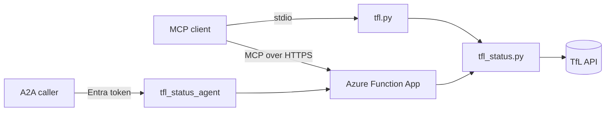

# TFL MCP

Live London transport data as MCP tools, plus an A2A agent that answers travel questions with them.

**Status:** served as a hosted MCP server (Azure Function App); also runs locally over stdio.

## What it does

Five MCP tools over the official TfL API (Underground, DLR, Overground, Elizabeth line):

- `get_tfl_status`: current status of named lines.
- `get_disrupted_lines`: every line that is disrupted right now.
- `find_station`: resolve a place name to a station.
- `plan_journey`: up to three routes that reflect live disruption, leaving now, at a time, or arriving by a time.
- `get_arrivals`: next trains at a station.

`tfl_status_agent/` is a LangGraph agent that uses these tools to answer questions such as "fastest way from Waterloo to King's Cross right now". It speaks A2A, streams its progress, and is gated by Microsoft Entra ID.

## How it works

The TfL logic lives in `tfl_status.py` and is exposed twice: locally by `tfl.py` and hosted by `function_app/`.

## Tech stack

- **MCP** (Python SDK, FastMCP) and **Azure Functions**: the tool server, local and hosted.
- **LangGraph** and the **OpenAI Responses API**: the agent loop.
- **A2A** (`a2a-sdk`, FastAPI): agent-to-agent interface with streaming.
- **Azure Container Apps**, **Entra ID**, **Bicep**, **GitHub Actions**: hosting, access control, infrastructure and CI/CD.

---

Run it locally: [docs/development.md](docs/development.md). Deploy it: [deployment/](deployment/README.md).
