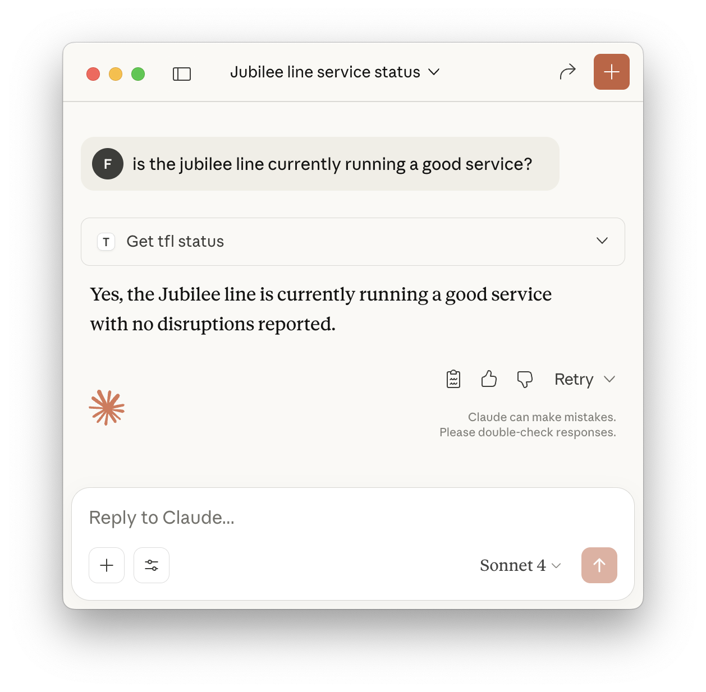
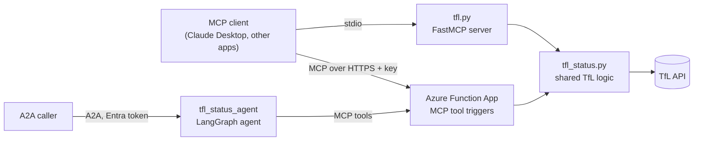

# TFL MCP

Live London transport data as MCP tools, plus an A2A agent that answers questions with them.

**Status:** the tools are served as a hosted MCP server (an Azure Function App) and can also run locally over stdio. There is no web page.



## What it does

Five tools give any MCP client (Claude Desktop, an agent, your own code) live data from the official TfL API for the Underground, DLR, Overground and Elizabeth line:

- **Check a line.** `get_tfl_status` reports the current status of one or more named lines, such as `victoria`, `dlr` or `mildmay`.
- **See what is broken right now.** `get_disrupted_lines` lists every line that is currently disrupted, without needing to name a line first.
- **Find a station.** `find_station` turns a place name into the station and journey ids the other tools need.
- **Plan a journey around disruption.** `plan_journey` returns up to three routes between two stations that reflect live disruption, leaving now, at a given time, or arriving by a given time, with an optional step-free preference.
- **Catch the next train.** `get_arrivals` lists the next trains arriving at a station, soonest first.

On top of the tools sits a conversational agent in `tfl_status_agent/`. It answers questions such as "fastest way from Waterloo to King's Cross right now" or "next Victoria line trains at Oxford Circus" by calling the tools above, and it has one local tool, `get_current_time`, so it can resolve relative times like "tomorrow at 9am". It speaks the A2A protocol, streams its progress (reasoning summaries, tool calls and results) while a task runs, and can be deployed as its own Container App gated by Microsoft Entra ID.

## How it works



The TfL logic lives in one module, `tfl_status.py`, and is exposed twice: by `tfl.py` as a local stdio server and by `function_app/` as the hosted server. The Function App is reachable on a public URL, but every MCP call needs a system key; that is acceptable because the data it serves is public.

The agent loads its tool schemas from the hosted MCP server when it starts, runs a LangGraph tool-calling loop on an OpenAI reasoning model, and publishes each step as an A2A status update before returning the final answer.

### Try it with Claude Desktop

Add the local stdio server to your Claude Desktop MCP configuration, pointing at a clone of this repo:

```json
{
  "mcpServers": {
    "tfl": {
      "command": "poetry",
      "args": ["run", "python", "tfl.py"],
      "cwd": "/path/to/tfl-mcp"
    }
  }
}
```

## Tech stack

- **MCP** (Python `mcp` SDK, FastMCP): the tool protocol, served over stdio locally.
- **Azure Functions** (Flex Consumption, MCP extension): the hosted MCP server.
- **LangGraph and LangChain**: the tool-calling agent loop.
- **OpenAI Responses API**: the agent's reasoning model.
- **A2A** (`a2a-sdk`, FastAPI, uvicorn): the agent-to-agent interface with streaming.
- **Azure Container Apps and Microsoft Entra ID**: hosting and token-based access control for the agent.
- **Bicep and GitHub Actions**: infrastructure as code, CI and manual deploys (OIDC, no stored credentials).
- **pytest, ruff, pyright**: tests, linting and type checking.

## Repository layout

- `tfl.py`, `tfl_status.py`: local MCP server and the shared TfL logic.
- `function_app/`: the hosted MCP server.
- `tfl_status_agent/`: the A2A agent.
- `infra/`, `scripts/`: Bicep and deploy tooling.

---

Run it locally: [docs/development.md](docs/development.md). Deploy it: [deployment/](deployment/README.md).
